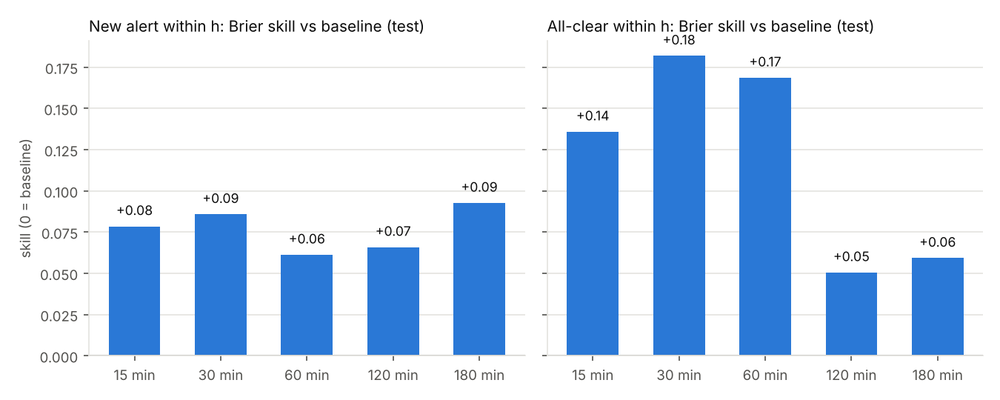
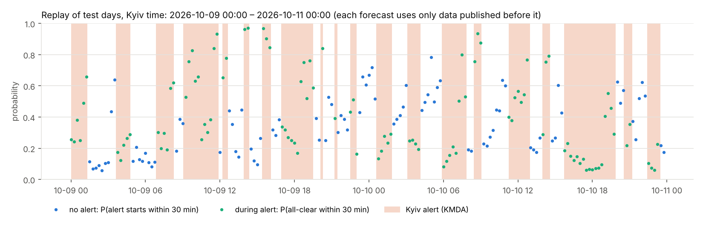
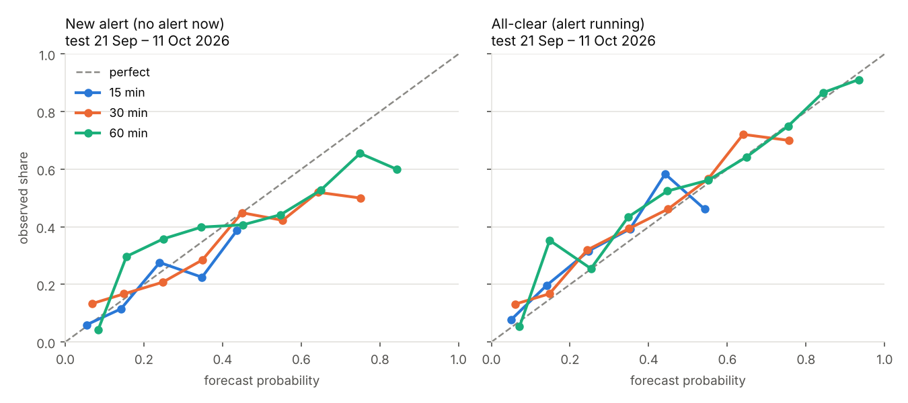

# Air-raid alert forecasting in Ukraine

Two forecasters built in this repository:

1. **Kyiv commuter forecaster (main result).** Every 15 minutes: if no alert is running, the chance that a new
   Kyiv alert starts within 15, 30, 60, 120 and 180 minutes; if an alert is running, the chance that the
   all-clear comes within the same windows. Data to 11 Oct 2026, tested on the last three weeks.
2. **24 places, hourly** (first version, below): the chance of a new alert within 1–24 h in every oblast's
   main city.

Both use only information published before the moment of the forecast, enforced by tests that are shown to
catch planted leaks. A forecast must never be used to ignore a real alert.

---

## Part 1 — Kyiv commuters, every 15 minutes

### The two decisions it is built for

| Where | Question | Forecast used |
|---|---|---|
| **Arsenalna**, alert running | Wait for the all-clear and cross the Dnipro on the red line, or walk to Zvirynetska / take the bus? | P(all-clear within 15–60 min), and the alert level |
| **Livoberezhna** (or on the way there from Osokorky / the Paton bridge), no alert | Will I cross the river before an alert closes the surface stations? | P(new alert within 15–30 min) |

City rules that matter (news reports, Sep 2026; check Kyiv Metro for the current ones): during an alert the red
line runs only underground, Akademmistechko–Arsenalna, and Dnipro, Hidropark, Livoberezhna, Darnytsia,
Chernihivska and Lisova close. Since 10 Sep, at the **yellow** level (drone danger) the green line still crosses
the Dnipro on the Southern bridge; at **red** it is split at Vydubychi / Slavutych.

### Data: cleaned for this goal

| Dataset (in `data/kyiv/`) | What it is | How it was checked |
|---|---|---|
| `kyiv_alerts.csv` | 2,653 Kyiv alert episodes, Feb 2022 – 12 Oct 2026, with yellow/red levels since 6 Sep 2026 | Built from the KMDA channel's fixed templates by a one-pass state machine. Matches the official channel 99–100 % (starts and all-clears within 5 min, median offset < 0.1 min) for 2022–2025 |
| `kyiv_levels.csv`, `kmda_alert_posts.csv` | every level change / alert post, with publication time | same |
| `signals.csv.gz` | 606k timestamped text signals from 4 channels: Kyiv target, Kyiv oblast, toward Kyiv, explosions, ballistic, MiG-31K, strategic aviation, missiles, jet drones, drones, launches, all-clears | rules unit-tested on typical lines; random matched lines in `reports/kyiv/signal_samples.md` |
| regional alerts | alert **starts** in Kyiv oblast, its neighbours and the country (volunteer data; end times not used) | — |

Why KMDA: the official alert channel went silent on 7 Sep 2026, a day after Kyiv switched to yellow/red levels,
and it had already stopped carrying many Kyiv alerts from 24 Aug (KMDA: ~50 alerts/week; official: 32, then
22). The volunteer series captures only 157 of the 242 Kyiv alerts after the switch. Details:
`reports/kyiv/cleaning.md`.

**The regime changed.** Kyiv had 14–17 alerts a week until mid-August 2026 and ~50 a week since 24 Aug; in
recent weeks the city was under alert 450–830 minutes a day.

### Results (test: 21 Sep – 11 Oct 2026, run once)

Weekly rolling origin: every Monday the model is refitted on everything known before that week, then forecasts
the week every 15 minutes. All choices (model type, recency weighting, recalibration, which channels) were made
on the 4 validation weeks (24 Aug – 20 Sep) and frozen before the test run. The baseline uses Kyiv's alert history only:
for a new alert, the share of the last 28 days on which one followed the same time of day; for the all-clear, the
share of recent alerts that ended within h minutes once they had lasted as long as this one.



| Horizon | New alert: observed rate | Brier skill | AUC model / baseline | All-clear: observed rate | Brier skill | AUC model / baseline |
|---|---|---|---|---|---|---|
| 15 min | 13 % | **+0.08** | 0.71 / 0.49 | 19 % | **+0.14** | 0.76 / 0.55 |
| 30 min | 26 % | **+0.09** | 0.67 / 0.49 | 33 % | **+0.18** | 0.75 / 0.55 |
| 60 min | 44 % | +0.06 | 0.63 / 0.50 | 53 % | **+0.17** | 0.75 / 0.57 |
| 120 min | 66 % | +0.07 | 0.62 / 0.46 | 74 % | +0.05 | 0.71 / 0.57 |
| 180 min | 78 % | +0.09 | 0.62 / 0.45 | 84 % | +0.06 | 0.76 / 0.56 |

What the probabilities mean in practice (same test predictions, grouped by the forecast; table added after the
test run, the model is unchanged):

| Forecast band | Livoberezhna: share of moments | ...an alert started within 30 min | Arsenalna: share of moments | ...the all-clear came within 30 min |
|---|---|---|---|---|
| < 10 % | 17 % | 13 % | 19 % | 13 % |
| 10–20 % | 23 % | 17 % | 25 % | 17 % |
| 20–30 % | 21 % | 21 % | 18 % | 32 % |
| 30–50 % | 26 % | 35 % | 19 % | 42 % |
| ≥ 50 % | 12 % | 48 % | 19 % | 68 % |

The baseline cannot separate moments like this: its bands all sit at 20–31 % (new alert) and 18–36 % (all-clear).

* **Arsenalna:** "wait if P(all-clear within 30 min) ≥ 50 %" is the right call 74 % of the time (baseline 65 %).
  Red-level alerts were only 41 test moments (90 % right vs 68 %); too few to rely on.
* **Livoberezhna:** a "≤ 10 % / ≤ 20 % chance of being caught" rule tuned on the calmer validation weeks did
  **not** hold on test (16 % and 26 % caught): absolute risk levels move from week to week. Read the forecast as a
  risk level, not a guarantee.
* **Which sources help** (validation, mean log-loss over horizons, lower is better; baseline 0.602 / 0.565):

  | Features added in turn | New alert | All-clear |
  |---|---|---|
  | Kyiv alert history only | 0.550 | 0.596 |
  | + regional alerts (volunteer starts) | 0.547 | 0.551 |
  | + Air Force channel | 0.517 | 0.556 |
  | + alert-map channel | **0.484** | **0.545** |
  | + Monitoring UA | 0.492 | 0.571 |
  | + Mykolaiv Vanek | 0.497 | 0.598 |

  The volunteer monitoring channels added nothing on top of the Air Force and alert-map channels, so the final
  models do not use them (measured, not assumed).
* Logistic regression beat boosted trees in both tasks: trees cannot extrapolate to the escalation weeks.





### Use it

**Right now (live):** in Google Colab (works on any computer; Windows security policies can block numpy locally):

```python
!git clone https://github.com/MrVenitar/Kyiv-air-raid-forecast.git
%cd Kyiv-air-raid-forecast
!pip -q install -r requirements.txt
!git clone -q https://github.com/Vadimkin/ukrainian-air-raid-sirens-dataset.git data/sirens
!python kyiv/live.py
```

`kyiv/live.py` reads the newest posts from the channels' public web pages (no login, no token):
KMDA `t.me/s/KyivCityOfficial` (alerts and levels), Air Force `t.me/s/kpszsu`, alert map `t.me/s/povitryanatrivogaaa`,
and eTryvoga `t.me/s/UkraineAlarmSignal` for regional alerts, parsed with the alert dataset's own rules and continued
from its last processed message. It pages back until it meets the stored data, so the history has no gap (if the
KMDA history cannot be reached it stops instead of guessing). Run it again for a fresh forecast; nothing is saved.

If the regional page cannot be read, it falls back to `models/kyiv_*_live.json`: the new-alert model without regional
features (almost as good: test log-loss 0.569 vs 0.564, baseline 0.597) and, for the all-clear, the duration
baseline, because without regional alerts the all-clear model is worse than the baseline on validation (0.592 vs
0.565). Details: `reports/kyiv/live_variant.md`. The live code is tested offline on simulated pages
(`kyiv/test_live.py`); the real pages are read only on your machine or in Colab.

**At any past moment covered by the data:**

```bash
python kyiv/forecast.py --at "2026-10-10 08:15"     # Kyiv local time; only data published before it is used
python kyiv/forecast.py                             # at the end of the stored data (11 Oct 2026, 20:15)
```

```
Kyiv, 2026-10-11 20:15 (Kyiv time). Data used: published before this moment only.
ALERT RUNNING for 66 min, level: yellow (drone danger).
Chance the all-clear comes within ...
            forecast  baseline
   15 min       45%       21%
   30 min       71%       32%
   60 min       90%       54%
```

(The all-clear came at 20:17–20:18 by both KMDA and the alerts.in.ua app.) Models are stored as plain JSON
(`models/*.json`, numpy-only prediction, identical to scikit-learn to 1e-16), so they load with any library version.

### Train it yourself (here or in Google Colab)

`kyiv/colab_train.ipynb` runs everything on a free CPU runtime (~1 h). The same steps from a shell:

```bash
pip install -r requirements.txt
bash scripts/get_data.sh                                  # regional alert history (pinned snapshot)
python kyiv/test_kyiv_leakage.py                          # streaming-vs-batch + planted leak
python kyiv/train.py --stage tables
python kyiv/train.py --stage validate --task onset        # choices are made here
python kyiv/train.py --stage validate --task clear
python kyiv/train.py --stage test                         # once
python kyiv/train.py --stage final && python kyiv/report.py
python kyiv/train.py --stage live                         # models without regional alerts (live fallback)
python kyiv/test_live.py                                  # live mode, offline on simulated Telegram pages
```

Rebuilding the datasets from your own Telegram exports (Telegram Desktop -> Export chat history -> HTML):
`python src/tg_export.py <folder> data/tg_<name>.csv.gz` for `kmda`, `alertmap`, `monitoring`, `vanek`
(and `kpszsu` for the Air Force), then `python kyiv/clean_alerts.py` and `python kyiv/signals.py`.

### Limitations (Kyiv)

* **Three test weeks**, all in the new two-level regime; red-level alerts are rare in them.
* **Telegram edits are invisible** in exports: a message counts with its final text from its publication time.
* **Text signals are keyword rules.** "Toward Kyiv" still fires for some drones leaving via Chornobyl/Dymer
  toward Zhytomyr oblast; news lines that mention Kyiv can slip in.
* **Regional alerts after 7 Sep exist only in the volunteer data**, and only their start times are used.
* **Recalibration offsets** in `models/` were measured on the last week of data (to 11 Oct); for later dates,
  retrain with fresh exports. The live mode uses them as they are.
* **"⚠ Київ / 🏍 … над містом!"**: the Air Force often names the city on its own line and the threat on the next;
  the line-by-line rules miss that (same in training and live use). Found by the live-mode test; fixing it means
  rebuilding the signals and re-running validation and test.
* The KMDA all-clear is citywide; the Southern-bridge and metro rules can change, so check them.

---

## Part 2 — 24 places, hourly (first version)

Every hour, for 24 places (Kyiv City and the main city of every other oblast except Luhansk), the model
gives the probability that a **new air-raid alert starts** there within the next **1, 3, 6, 12 and 24 hours**.
It uses the alert history and the Ukrainian Air Force's public Telegram channel, and nothing published after
the moment of the forecast (enforced by tests that are shown to catch planted leaks).

Two pipelines share all code and differ only in the alert source:

| | Volunteer (eTryvoga) | Official («Повітряна тривога», @air_alert_ua) |
|---|---|---|
| Place | oblast (as eTryvoga reports it), Kyiv City | main city: oblast-wide, city-raion or city-hromada alert |
| Covers | to **11 Oct 2026** (latest) | to **7 Sep 2026** — the channel has posted nothing since |
| Test (last 4 weeks, used once) | 12 Sep – 10 Oct 2026 | 9 Aug – 6 Sep 2026 |
| Validation (all choices) | 14 Aug – 11 Sep 2026 | 11 Jul – 8 Aug 2026 |

### Why this target

Forecasts are for decisions, so the target came from who would use them:

| Who | Decision | Horizon |
|---|---|---|
| Commuter (e.g. Kyiv) | leave now or later, metro or car | 1–3 h |
| Household | sleep in the corridor/shelter tonight | ~9 h, at 22:00 |
| Small business | open, shorten hours, staff | next day |
| Utilities, crews, hospitals | pre-position crews, schedule elective surgery | the coming night |
| Logistics | route across oblasts | 3–12 h |

Nearly all of them ask "will a **new** alert start in my window?" (an alert that is on is already in their app), and
about **their city**, not their oblast: since late 2025 alerts are issued per raion, and in Jun–Aug 2026 some raion
of Kharkiv oblast was under alert 93 % of the time. Each user trades false alarms against misses differently, so
the output is a **calibrated probability**, evaluated with Brier score, log-loss and reliability, plus an
operational table with false-warning caps. A forecast must never be used to ignore a real alert.

### Results

Brier skill is relative to a strong, honest baseline: the share of the last 28 days on which an alert onset
followed the same local hour at the same place. 0 = as good as the baseline; higher is better.


**Selected model vs baseline on the test weeks** (model, window, features and recalibration all chosen on validation):

| Horizon | Volunteer: onset rate | skill | AUC model / baseline | Official: onset rate | skill | AUC model / baseline |
|---|---|---|---|---|---|---|
| 1 h | 0.23 | **+0.035** | 0.775 / 0.749 | 0.12 | **+0.131** | 0.834 / 0.760 |
| 3 h | 0.49 | **+0.041** | 0.814 / 0.799 | 0.28 | **+0.114** | 0.848 / 0.807 |
| 6 h | 0.67 | +0.029 | 0.854 / 0.853 | 0.39 | +0.011 | 0.842 / 0.837 |
| 12 h | 0.80 | +0.058 | 0.919 / 0.913 | 0.49 | **+0.127** | 0.891 / 0.858 |
| 24 h | 0.87 | −0.053 | 0.975 / 0.969 | 0.58 | +0.001 | 0.880 / 0.873 |

What this says:

* **City-level official alerts are forecastable beyond the baseline at 1–3 h and 12 h** (Brier −11 to −13 %,
  AUC +0.03 to +0.07). The gain comes from each place's own recent alerts and from alerts in neighbouring
  oblasts (drone waves cross regions over hours).
* **On the latest period (volunteer data) the gain is small** (+0.03 to +0.06). The test weeks were the most
  intense in the data (a 24 h window contained an onset 87 % of the time), and the volunteer series is
  noisier (see limitations).
* **The Air Force text helps on the latest period and not on the official one.** Volunteer: text adds
  +0.005 to +0.078 skill over "+spatial" at every horizon. Official: adding text is neutral or worse on test than "+spatial",
  even where validation preferred it. It is reported as is.
* **24 h is near the baseline in both sources.** Validation picked a configuration that lost to the
  baseline on volunteer test (−0.053); the test-best variant was not substituted.
* Per place (3 h, test): official skill is highest for Kharkiv (+0.24), Sumy (+0.21) and Poltava (+0.17)
  and +0.08 for Kyiv City. On volunteer data Kyiv City is −0.025, so the model does **not** beat the
  baseline for Kyiv commuters on the latest weeks. Full table in `reports/summary.md`.

Reliability (test): forecasts are close to the diagonal at 1 and 6 h; the volunteer 24 h model, chosen without
recalibration, under-forecasts.


**Operational table** (official, test; warning thresholds set on validation to allow ≤ N false warning-hours per
place per week):

| Horizon | Cap N | False warnings/place/week on test | Onsets warned (model) | Onsets warned (baseline) |
|---|---|---|---|---|
| 1 h | 3 | 2.5 | **19.7 %** | 6.5 % |
| 3 h | 3 | 2.1 | **34.6 %** | 26.4 % |
| 6 h | 1 | 1.1 | **44.4 %** | 22.4 % |
| 12 h | 3 | 4.9 | 81.4 % | 76.0 % |
| 24 h | 1 | **6.6** (cap broken) | 87.3 % | 70.7 % |

At long horizons thresholds tuned on one month do not hold in the next one (24 h: 6.6 false warnings per week
against a cap of 1). On volunteer data the model and baseline warn about the same share of onsets. All rows:
`reports/*/operational.csv`.

### Method

* **Label** for horizon H at hour t: a new alert episode starts at the place in [t, t+H). Alerts overlapping
  at a place are merged into episodes; an onset is an episode start.
* **Features** (only information before t):
  * calendar: Kyiv local hour, weekday, place;
  * recent rates: onset frequency over the past 7/28 days, same hour over 28 days, national, all from
    labels that had finished by t;
  * own history: alert running now, hours since last onset/end, onsets in the last 1–168 h, minutes under
    alert in the last 24/168 h;
  * spatial: neighbouring oblasts and the whole country (running now, recent onsets), and for the official
    source any alert anywhere in the oblast;
  * Air Force text: mentions of the place and its neighbours, threat types (drones, jet drones, ballistic,
    cruise missiles, guided bombs, MiG-31K, strategic aviation, all-clear). Counts are divided by their own
    28-day level, because the channel's posting volume tripled in 2026.
* **Models:** logistic regression and histogram gradient boosting (scikit-learn's LightGBM-style learner),
  trained on everything up to the validation month. Model family, training start (Jan or Dec 2025), feature
  set and online recalibration are chosen per horizon by validation log-loss. Test is scored once.
* **Online recalibration:** each hour, forecasts' log-odds are shifted by the gap between the observed and
  predicted onset rates of the past week, using only labels that have finished. This tracks fast changes in
  attack intensity; validation turned it on in 9 of 10 cases.
* **No leakage, tested** (`tests/test_leakage.py`, runs with or without pytest):
  1. Streaming vs batch: for 24 random hours per source (half of them during a running alert) everything is
     rebuilt from rows known at that hour (an unfinished alert's end unknown, only earlier messages) and must
     equal the batch features exactly.
  2. Recent-rate features and online recalibration do not change when every unfinished label is scrambled.
  3. Each test was checked against a deliberately planted leak and failed as it should (see `VERSIONS.md`).
* **Time zones:** the alert data is in UTC; Telegram exports show the Kyiv wall clock and were localised as
  Europe/Kyiv. This was verified against the clock printed inside 99 % of alert messages.

### Limitations

* **No official alerts after 7 Sep 2026.** The latest period is evaluated on volunteer data only.
* **The volunteer data is not ground truth.**
  * For Kyiv City in Jun–Aug 2026, only 51 % of its alert starts fall within 5 min of an official start.
  * 23 % of recent Kyiv City volunteer alerts have a guessed end time.
  * In Volyn and Lviv oblasts the volunteer data has ~4× more alerts than the official channel, and the
    Air Force rarely mentions those regions near the extra alerts (`python src/audit.py`).
* **Telegram exports keep only a message's final text.** An edit made after publication would leak; the HTML
  export does not mark edits.
* **One test month per source.** Differences of ±0.02 in skill are within month-to-month noise.
* The Air Force text features are keyword counts, not language understanding. Place names outside the
  dictionary (small villages) are missed.

### Reproduce

```bash
pip install -r requirements.txt
bash scripts/run_all.sh          # 11 Oct data snapshot, leakage tests, both pipelines, figures (~15 min, 2 CPUs)
python src/audit.py              # the data checks that changed the plan
```

The parsed Air Force channel is included (`data/tg_kpszsu.csv.gz`, 84,925 messages, Feb 2019 – 11 Oct 2026).
To rebuild it from a Telegram Desktop HTML export: `python src/tg_export.py <export folder> data/tg_kpszsu.csv.gz`.
The alert data is cloned by `scripts/get_data.sh` (pinned commit; `latest` for today's).

### Layout

```
kyiv/clean_alerts.py   KMDA posts -> Kyiv alert episodes (+ levels), validated against official / volunteer
kyiv/signals.py        4 Telegram channels -> timestamped Kyiv-relevant signals
kyiv/features.py       15-min features from event lists; onset and all-clear labels; baselines
kyiv/train.py          weekly rolling origin; validation choices; one test run; final models
kyiv/forecast.py       forecast at any moment;  kyiv/live.py  forecast right now;  kyiv/report.py  figures
kyiv/test_kyiv_leakage.py, kyiv/test_live.py, kyiv/colab_train.ipynb, kyiv/model_utils.py (numpy predictor)
models/                trained Kyiv models;  reports/kyiv/  cleaning, signals, validation, test
src/data.py         alert sources -> per-place episodes (main-city mapping, neighbours)
src/features.py     features known at t, labels, recent rates, online recalibration
src/run.py          splits, baselines, model choice on validation, ablation, operational table
src/report.py       figures + reports/summary.md
src/audit.py        data checks behind the design decisions
src/tg_export.py    Telegram Desktop HTML export -> table (Kyiv clock -> UTC)
tests/test_leakage.py
reports/            results of the run reported above
VERSIONS.md         what changed, what went wrong, why
```

The project was built with an AI assistant (Claude) as the main engineering tool. `VERSIONS.md` records the
wrong assumptions found and corrected along the way.
