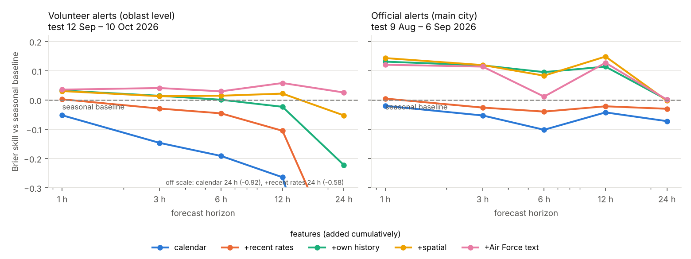
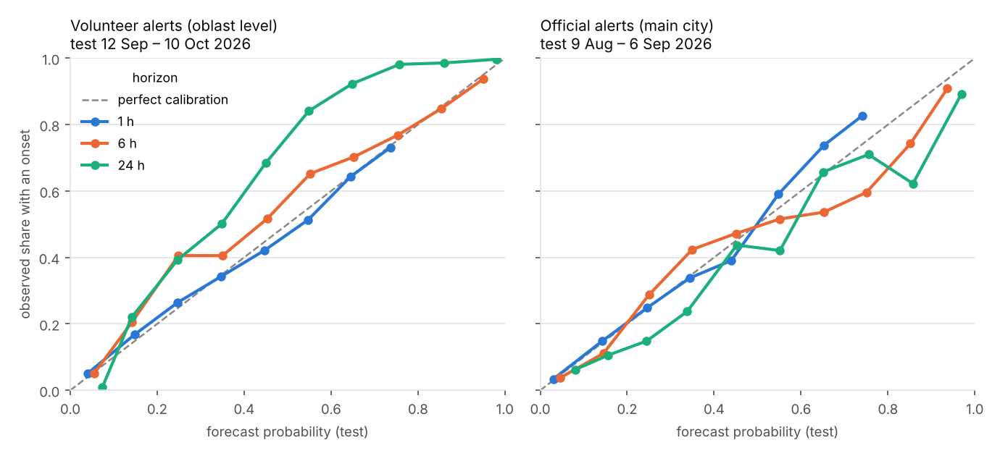

# Forecasting new air-raid alerts in Ukraine (1–24 h ahead)

Every hour, for 24 places (Kyiv City and the main city of every other oblast except Luhansk), the model
gives the probability that a **new air-raid alert starts** there within the next **1, 3, 6, 12 and 24 hours**.
It uses the alert history and the Ukrainian Air Force's public Telegram channel, and nothing published after
the moment of the forecast (enforced by tests that are shown to catch planted leaks).

Two pipelines share all code and differ only in the alert source:

| | Volunteer (eTryvoga) | Official («Повітряна тривога», @air_alert_ua) |
|---|---|---|
| Place | oblast (as eTryvoga reports it), Kyiv City | main city: oblast-wide, city-raion or city-hromada alert |
| Covers | to **11 Oct 2026** (latest) | to **7 Sep 2026** — the channel has posted nothing since |
| Test (last 4 weeks, used once) | 12 Sep – 10 Oct 2026 | 9 Aug – 6 Sep 2026 |
| Validation (all choices) | 14 Aug – 11 Sep 2026 | 11 Jul – 8 Aug 2026 |

## Why this target

Forecasts are for decisions, so the target came from who would use them:

| Who | Decision | Horizon |
|---|---|---|
| Commuter (e.g. Kyiv) | leave now or later, metro or car | 1–3 h |
| Household | sleep in the corridor/shelter tonight | ~9 h, at 22:00 |
| Small business | open, shorten hours, staff | next day |
| Utilities, crews, hospitals | pre-position crews, schedule elective surgery | the coming night |
| Logistics | route across oblasts | 3–12 h |

Nearly all of them ask "will a **new** alert start in my window?" (an alert that is on is already in their app), and
about **their city**, not their oblast: since late 2025 alerts are issued per raion, and in Jun–Aug 2026 some raion
of Kharkiv oblast was under alert 93 % of the time. Each user trades false alarms against misses differently, so
the output is a **calibrated probability**, evaluated with Brier score, log-loss and reliability, plus an
operational table with false-warning caps. A forecast must never be used to ignore a real alert.

## Results

Brier skill is relative to a strong, honest baseline: the share of the last 28 days on which an alert onset
followed the same local hour at the same place. 0 = as good as the baseline; higher is better.



**Selected model vs baseline on the test weeks** (model, window, features and recalibration all chosen on validation):

| Horizon | Volunteer: onset rate | skill | AUC model / baseline | Official: onset rate | skill | AUC model / baseline |
|---|---|---|---|---|---|---|
| 1 h | 0.23 | **+0.035** | 0.775 / 0.749 | 0.12 | **+0.131** | 0.834 / 0.760 |
| 3 h | 0.49 | **+0.041** | 0.814 / 0.799 | 0.28 | **+0.114** | 0.848 / 0.807 |
| 6 h | 0.67 | +0.029 | 0.854 / 0.853 | 0.39 | +0.011 | 0.842 / 0.837 |
| 12 h | 0.80 | +0.058 | 0.919 / 0.913 | 0.49 | **+0.127** | 0.891 / 0.858 |
| 24 h | 0.87 | −0.053 | 0.975 / 0.969 | 0.58 | +0.001 | 0.880 / 0.873 |

What this says:

* **City-level official alerts are forecastable beyond the baseline at 1–3 h and 12 h** (Brier −11 to −13 %,
  AUC +0.03 to +0.07). The gain comes from each place's own recent alerts and from alerts in neighbouring
  oblasts (drone waves cross regions over hours).
* **On the latest period (volunteer data) the gain is small** (+0.03 to +0.06). The test weeks were the most
  intense in the data (a 24 h window contained an onset 87 % of the time), and the volunteer series is
  noisier (see limitations).
* **The Air Force text helps on the latest period and not on the official one.** Volunteer: text adds
  +0.005 to +0.078 skill over "+spatial" at every horizon. Official: adding text is neutral or worse on test than "+spatial",
  even where validation preferred it. It is reported as is.
* **24 h is near the baseline in both sources.** Validation picked a configuration that lost to the
  baseline on volunteer test (−0.053); the test-best variant was not substituted.
* Per place (3 h, test): official skill is highest for Kharkiv (+0.24), Sumy (+0.21) and Poltava (+0.17)
  and +0.08 for Kyiv City. On volunteer data Kyiv City is −0.025, so the model does **not** beat the
  baseline for Kyiv commuters on the latest weeks. Full table in `reports/summary.md`.

Reliability (test): forecasts are close to the diagonal at 1 and 6 h; the volunteer 24 h model, chosen without
recalibration, under-forecasts.



**Operational table** (official, test; warning thresholds set on validation to allow ≤ N false warning-hours per
place per week):

| Horizon | Cap N | False warnings/place/week on test | Onsets warned (model) | Onsets warned (baseline) |
|---|---|---|---|---|
| 1 h | 3 | 2.5 | **19.7 %** | 6.5 % |
| 3 h | 3 | 2.1 | **34.6 %** | 26.4 % |
| 6 h | 1 | 1.1 | **44.4 %** | 22.4 % |
| 12 h | 3 | 4.9 | 81.4 % | 76.0 % |
| 24 h | 1 | **6.6** (cap broken) | 87.3 % | 70.7 % |

At long horizons thresholds tuned on one month do not hold in the next one (24 h: 6.6 false warnings per week
against a cap of 1). On volunteer data the model and baseline warn about the same share of onsets. All rows:
`reports/*/operational.csv`.

## Method

* **Label** for horizon H at hour t: a new alert episode starts at the place in [t, t+H). Alerts overlapping
  at a place are merged into episodes; an onset is an episode start.
* **Features** (only information before t):
  * calendar: Kyiv local hour, weekday, place;
  * recent rates: onset frequency over the past 7/28 days, same hour over 28 days, national, all from
    labels that had finished by t;
  * own history: alert running now, hours since last onset/end, onsets in the last 1–168 h, minutes under
    alert in the last 24/168 h;
  * spatial: neighbouring oblasts and the whole country (running now, recent onsets), and for the official
    source any alert anywhere in the oblast;
  * Air Force text: mentions of the place and its neighbours, threat types (drones, jet drones, ballistic,
    cruise missiles, guided bombs, MiG-31K, strategic aviation, all-clear). Counts are divided by their own
    28-day level, because the channel's posting volume tripled in 2026.
* **Models:** logistic regression and histogram gradient boosting (scikit-learn's LightGBM-style learner),
  trained on everything up to the validation month. Model family, training start (Jan or Dec 2025), feature
  set and online recalibration are chosen per horizon by validation log-loss. Test is scored once.
* **Online recalibration:** each hour, forecasts' log-odds are shifted by the gap between the observed and
  predicted onset rates of the past week, using only labels that have finished. This tracks fast changes in
  attack intensity; validation turned it on in 9 of 10 cases.
* **No leakage, tested** (`tests/test_leakage.py`, runs with or without pytest):
  1. Streaming vs batch: for 24 random hours per source (half of them during a running alert) everything is
     rebuilt from rows known at that hour (an unfinished alert's end unknown, only earlier messages) and must
     equal the batch features exactly.
  2. Recent-rate features and online recalibration do not change when every unfinished label is scrambled.
  3. Each test was checked against a deliberately planted leak and failed as it should (see `VERSIONS.md`).
* **Time zones:** the alert data is in UTC; Telegram exports show the Kyiv wall clock and were localised as
  Europe/Kyiv. This was verified against the clock printed inside 99 % of alert messages.

## Limitations

* **No official alerts after 7 Sep 2026.** The latest period is evaluated on volunteer data only.
* **The volunteer data is not ground truth.**
  * For Kyiv City in Jun–Aug 2026, only 51 % of its alert starts fall within 5 min of an official start.
  * 23 % of recent Kyiv City volunteer alerts have a guessed end time.
  * In Volyn and Lviv oblasts the volunteer data has ~4× more alerts than the official channel, and the
    Air Force rarely mentions those regions near the extra alerts (`python src/audit.py`).
* **Telegram exports keep only a message's final text.** An edit made after publication would leak; the HTML
  export does not mark edits.
* **One test month per source.** Differences of ±0.02 in skill are within month-to-month noise.
* The Air Force text features are keyword counts, not language understanding. Place names outside the
  dictionary (small villages) are missed.

## Reproduce

```bash
pip install -r requirements.txt
bash scripts/run_all.sh          # data (pinned snapshot), leakage tests, both pipelines, figures (~15 min, 2 CPUs)
python src/audit.py              # the data checks that changed the plan
```

The parsed Air Force channel is included (`data/tg_kpszsu.csv.gz`, 84,925 messages, Feb 2019 – 11 Oct 2026).
To rebuild it from a Telegram Desktop HTML export: `python src/tg_export.py <export folder> data/tg_kpszsu.csv.gz`.
The alert data is cloned by `scripts/get_data.sh` (pinned commit; `latest` for today's).

## Layout

```
src/data.py         alert sources -> per-place episodes (main-city mapping, neighbours)
src/features.py     features known at t, labels, recent rates, online recalibration
src/run.py          splits, baselines, model choice on validation, ablation, operational table
src/report.py       figures + reports/summary.md
src/audit.py        data checks behind the design decisions
src/tg_export.py    Telegram Desktop HTML export -> table (Kyiv clock -> UTC)
tests/test_leakage.py
reports/            results of the run reported above
VERSIONS.md         what changed, what went wrong, why
```

The project was built with an AI assistant (Claude) as the main engineering tool. `VERSIONS.md` records the
wrong assumptions found and corrected along the way.
